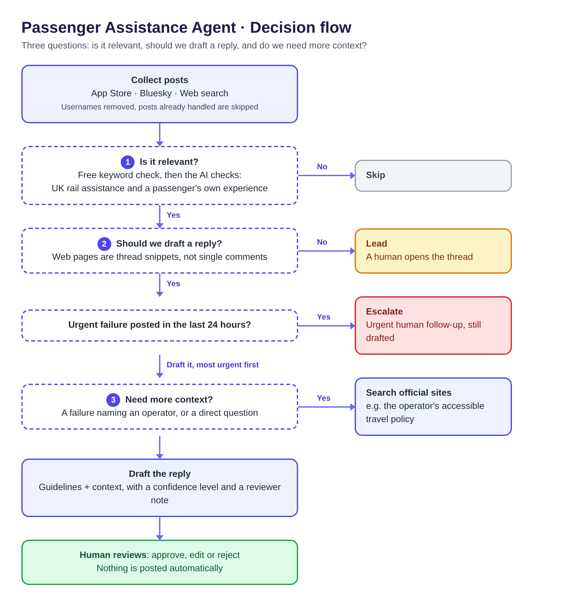

# Decision flow

1. **Is it relevant?** A free keyword check runs first. The AI then checks that the post is about UK rail assistance and is a passenger's own experience. If not, it is skipped.
2. **Should we draft a reply?** Web results are snippets of a thread, so they become leads for a human to open. An urgent failure posted in the last 24 hours is escalated for urgent human follow-up, and still gets a draft. Everything else is drafted, most urgent first.
3. **Do we need more context?** If the post reports a failure and names an operator, or asks a direct question, the agent searches official sites (for example, the operator's accessible travel policy) before drafting.

Every draft goes to a human, who approves, edits or rejects it. Nothing is posted automatically.
